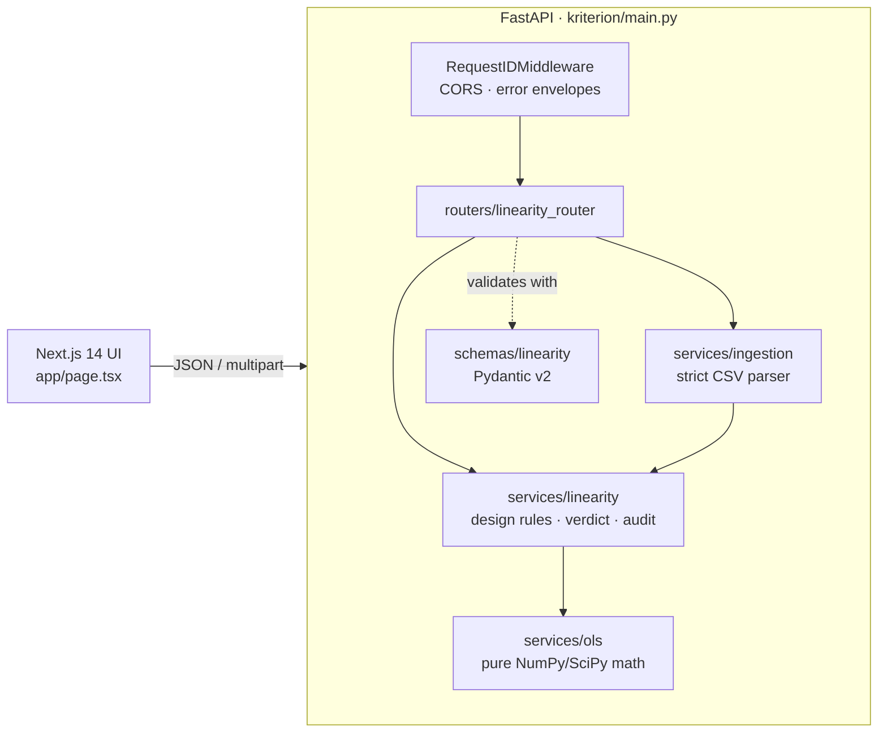

# Kriterion — HPLC Method Validation Engine ⚗️📈

*[Español](README.es.md) | [Deutsch](README.de.md) | [中文](README.zh.md)*

-success.svg?style=for-the-badge)


> **A deterministic, API-first statistical engine that replaces validation spreadsheets with reproducible, auditable calculations.**

Kriterion automates the statistical evaluation of High-Performance Liquid Chromatography (HPLC) methods for pharmaceutical QC and R&D laboratories. The numerical core is a small, dependency-light Python service that performs Ordinary Least Squares (OLS) linearity assessment, evaluates acceptance criteria, and stamps every result with a traceable audit record.

**Contents** — [Why Kriterion](#-why-kriterion) · [Architecture](#-architecture) · [Quick start](#-quick-start) · [API reference](#-api-reference) · [Statistical methodology](#-statistical-methodology) · [Data ingestion](#-data-ingestion-csv) · [Data integrity](#-data-integrity-alcoa) · [Codebase tour](#-codebase-tour) · [Deployment](#-deployment-vercel) · [Testing](#-testing) · [Configuration](#-configuration) · [Status & roadmap](#-status--roadmap)

---

## 🎯 Why Kriterion

Method validation is still frequently done in Excel. That means transcription errors, silent formula drift, no enforced version control, and hours of manual second-person review.

Kriterion moves the mathematics out of the spreadsheet and the browser into one tested, versioned service:

| Problem with spreadsheets | Kriterion's approach |
|---|---|
| Formulas edited in place, unnoticed | Single implementation, covered by unit tests cross-checked against SciPy |
| Rows silently skipped or mis-parsed on import | Strict ingestion: any ambiguous row **aborts** the import with line numbers |
| No proof of what was calculated from what | Every response carries a SHA-256 fingerprint of the inputs, a UTC timestamp, engine version and request ID |
| Pass/fail decided by eye | Acceptance criteria evaluated server-side and returned as structured data |
| Results not reproducible | Pure functions, no hidden state: identical input ⇒ identical output |

---

## 🏗 Architecture



Layering rule: **dependencies point inward.** `ols.py` knows nothing about HTTP, files or Pydantic; `ingestion.py` knows nothing about statistics; the router only translates between HTTP and services. This keeps the math testable in isolation and makes the engine reusable from a CLI, notebook or batch job.

---

## 🚀 Quick start

```bash
git clone <your-repo-url> kriterion && cd kriterion
python -m venv .venv && source .venv/bin/activate
pip install -r requirements-dev.txt
pytest                                           # run the backend test suite
uvicorn kriterion.main:app --reload --port 8000  # API on :8000

# in a second terminal
npm install
npm run dev                                      # UI on :3000, proxies /api/* to :8000
```

Open <http://localhost:3000>. Interactive API docs: <http://localhost:8000/api/docs>

```bash
curl -s localhost:8000/api/v1/linearity/calculate \
  -H 'Content-Type: application/json' \
  -d '{"concentrations":[10,20,30,40,50],
       "areas":[12520,24985,37540,50012,62490],
       "r_squared_limit":0.999}'
```

---

## 📡 API reference

### `POST /api/v1/linearity/calculate`

JSON body:

| Field | Type | Default | Notes |
|---|---|---|---|
| `concentrations` | `float[]` | — | 1–1000 finite values (NaN/Inf rejected) |
| `areas` | `float[]` | — | Same length and order as `concentrations` |
| `r_squared_limit` | `float` | `0.999` | Acceptance limit, `0 < x ≤ 1` |
| `confidence_level` | `float` | `0.95` | For slope/intercept intervals, `0 < x < 1` |

Unknown fields are rejected (`extra="forbid"`).

### `POST /api/v1/linearity/calculate/csv`

`multipart/form-data` with `file` (CSV, ≤ 1 MB) plus optional `r_squared_limit` and `confidence_level` form fields. Parsed with the strict rules in [Data ingestion](#-data-ingestion-csv), then evaluated by the same engine.

### Response (abridged, reference dataset)

```json
{
  "slope": 1249.67,
  "intercept": 19.3,
  "r_squared": 0.9999987716,
  "is_compliant": true,
  "verdict": "PASS",
  "n_points": 5,
  "degrees_of_freedom": 3,
  "residual_std_error": 25.287,
  "slope_stats": {
    "estimate": 1249.67, "std_error": 0.8,
    "confidence_interval": { "lower": 1247.13, "upper": 1252.21 }
  },
  "intercept_stats": {
    "estimate": 19.3, "std_error": 26.52,
    "confidence_interval": { "lower": -65.10, "upper": 103.70 }
  },
  "criteria": [
    { "name": "r_squared", "required": true, "passed": true, "observed": 0.9999987716, "limit": 0.999 },
    { "name": "intercept_includes_zero", "required": false, "passed": true, "observed": true }
  ],
  "fitted": [ "…" ],
  "residuals": [ "…" ],
  "audit": {
    "request_id": "9f2c…",
    "timestamp_utc": "2026-10-29T21:40:11Z",
    "engine": "kriterion-ols",
    "engine_version": "1.1.0",
    "input_sha256": "…",
    "source_filename": null,
    "source_file_sha256": null,
    "ingestion_warnings": []
  }
}
```

`slope`, `intercept`, `r_squared`, `is_compliant` remain top-level for simple clients; the nested objects carry the full statistics.

### Errors

All failures share one envelope and a stable `code`, and echo the `X-Request-ID` header:

```json
{ "error": { "code": "ingestion_error", "message": "1 row(s) could not be parsed; import aborted…",
             "details": ["Line 3: non-numeric value 'oops'."], "request_id": "…" } }
```

| HTTP | `code` | Cause |
|---|---|---|
| 422 | `invalid_request` | Body fails schema validation (types, lengths, NaN, unknown fields) |
| 422 | `invalid_input` | Violates a methodological rule (e.g. fewer than 5 distinct levels) |
| 422 | `ingestion_error` | File cannot be parsed unambiguously |
| 422 | `calculation_error` | Regression undefined (no variance in x or y, < 3 points) |
| 413 | `payload_too_large` | Upload exceeds 1 MB |
| 500 | `internal_error` | Unexpected; details are logged server-side, never leaked |

`GET /api/health` returns liveness and the engine version.

---

## 🔬 Statistical methodology

Kriterion fits a simple linear calibration model by OLS:

$$y_i = \beta_0 + \beta_1 x_i + \varepsilon_i$$

With $S_{xx}=\sum (x_i-\bar x)^2$ and $S_{xy}=\sum (x_i-\bar x)(y_i-\bar y)$:

$$\hat\beta_1 = \frac{S_{xy}}{S_{xx}}, \qquad \hat\beta_0 = \bar y - \hat\beta_1 \bar x$$

Goodness of fit and uncertainty, with $\text{RSS}=\sum (y_i-\hat y_i)^2$, $\text{TSS}=\sum (y_i-\bar y)^2$ and $\nu=n-2$:

$$R^2 = 1-\frac{\text{RSS}}{\text{TSS}}, \qquad s=\sqrt{\frac{\text{RSS}}{\nu}}$$

$$\text{SE}(\hat\beta_1)=\frac{s}{\sqrt{S_{xx}}}, \qquad \text{SE}(\hat\beta_0)=s\sqrt{\frac1n+\frac{\bar x^{2}}{S_{xx}}}$$

$$\hat\beta \;\pm\; t_{1-\alpha/2,\,\nu}\;\text{SE}(\hat\beta)$$

**Implementation notes** (`api/services/ols.py`)

- Data are **mean-centred** before computing $S_{xx}$ and $S_{xy}$, avoiding the cancellation error of the naive $n\sum x^2-(\sum x)^2$ form. A test fits values around $10^6$ with an offset of $10^9$.
- The correlation coefficient $r$ carries the sign of the slope.
- Undefined cases raise `CalculationError` instead of returning `NaN`: fewer than 3 points, no variation in concentration, no variation in response, length mismatch, non-finite values.
- Results are validated in the test suite against `scipy.stats.linregress` (slope, intercept, $r$, both standard errors, and confidence intervals).

**Acceptance criteria** (`api/services/linearity.py`)

| Criterion | Required | Rule |
|---|---|---|
| `r_squared` | ✅ | $R^2 \ge$ `r_squared_limit` (user-supplied, default 0.999) |
| `intercept_includes_zero` | informational | Confidence interval of $\beta_0$ contains 0 |

Design rule enforced before fitting: **at least 5 distinct concentration levels** (ICH Q2 recommendation). Replicates are allowed but do not count as extra levels.

> **Scope note.** ICH Q2(R2) does not prescribe a numeric $R^2$ limit; the threshold is a method-specific acceptance criterion that you define in your validation protocol. Kriterion evaluates the limit you provide — it does not decide what the limit should be. $R^2$ alone can also mask curvature: review the returned `residuals` for systematic patterns.

---

## 📥 Data ingestion (CSV)

`api/services/ingestion.py` is built around one principle: **never silently drop data.** A calibration point that vanishes during import changes the regression and the verdict.

| Feature | Behaviour |
|---|---|
| Encodings | UTF-8 (with/without BOM); falls back to Windows-1252 with a warning; binary files rejected |
| Delimiters | Auto-detected: `;`, tab, `,` |
| Decimals | Decimal comma accepted when delimiter is not `,` (ES/DE exports) |
| Header | Optional single header row; a row with one numeric and one text cell is an error |
| Numeric tokens | Strict pattern. `nan`, `inf`, `1_000`, `0x10` and thousands separators (`1.234,5`) are **rejected, not guessed** |
| Bad rows | Import aborts; up to 20 line-numbered issues returned |
| Extra columns | Ignored, with a warning in `audit.ingestion_warnings` |
| Limits | 1 MB, 1000 rows |
| Provenance | SHA-256 of the raw file bytes returned as `audit.source_file_sha256` |

Example accepted file:

```csv
concentration;area
10,0;12520,0
20,0;24985,0
30,0;37540,0
40,0;50012,0
50,0;62490,0
```

---

## 🧾 Data integrity (ALCOA+)

Kriterion is designed to *support* a GxP data-integrity programme. It is not, by itself, a validated or certified system. Honest mapping of what exists today:

| Principle | Implemented now | Not yet implemented |
|---|---|---|
| **Attributable** | `X-Request-ID` on every request/response/log line (client IDs accepted only from a safe alphabet) | User identity / authentication |
| **Legible** | Structured JSON results; stable error codes | Formal report rendering (PDF) |
| **Contemporaneous** | UTC timestamps in logs and responses | — |
| **Original** | SHA-256 of raw uploaded file and of canonical numeric inputs | Storage of original files |
| **Accurate** | Strict ingestion; reference-validated math; no silent coercion | — |
| **Complete** | Import aborts on any bad row | — |
| **Consistent** | Single code path for JSON and CSV; UTC everywhere | — |
| **Enduring / Available** | — | Persistent, append-only audit store |

Regulatory items such as 21 CFR Part 11 (electronic signatures, access control, audit-trail retention) and computerised-system validation (IQ/OQ/PQ) are **roadmap**, not claims.

---

## 🗂 Codebase tour

One repository, one root, one Vercel project.

```
app/                          Next.js 14 App Router (layout.tsx, page.tsx, globals.css)
api/index.py                  Vercel entrypoint: exposes the ASGI app, nothing else
kriterion/                    Python package (all backend logic)
├── main.py                   App factory, CORS, middleware, error handlers, /api/health
├── core/
│   ├── settings.py           Env-driven immutable settings; UTC logging config
│   ├── limits.py             Shared constants (min levels, max points, upload size)
│   ├── errors.py             Domain exceptions → HTTP status + stable error codes
│   └── middleware.py         Request-ID propagation
├── schemas/linearity.py      Pydantic v2 request/response contracts
├── services/
│   ├── ols.py                Pure OLS maths (no I/O)
│   ├── ingestion.py          Strict CSV parser
│   └── linearity.py          Design rules, criteria, verdict, audit record
└── routers/linearity_router.py   HTTP ↔ service glue
tests/                        OLS vs SciPy · ingestion edge cases · service · HTTP contract
vercel.json                   Routes /api/* to api/index.py
package.json · requirements.txt   Frontend and backend dependencies
```

The backend lives in `kriterion/`, not `api/`, on purpose: Vercel turns every Python file under `api/` into a serverless function, so `api/` holds only the entrypoint.

Engineering conventions: full type hints, frozen dataclasses with `slots`, `from __future__ import annotations`, no global mutable state, CPU-bound routes declared `def` so FastAPI runs them in its threadpool, and `async` only where the route awaits I/O (file upload).

---

## 🚢 Deployment (Vercel)

A single Vercel project serves both halves from the same domain, so there is no CORS configuration and no cross-project variables.

1. Import the repository in Vercel. Leave **Root Directory** empty (`./`) and **Framework Preset** on *Next.js*.
2. No environment variables are required. Deploy.
3. Verify: `/api/health` returns `{"status":"operational",…}`, `/api/docs` shows the OpenAPI UI, and the page returns **PASS** for the default dataset.

How it works: Vercel builds the Next.js app and, because `api/index.py` exists, also builds it as a Python function with the dependencies in `requirements.txt`. `vercel.json` rewrites every `/api/*` request to that function, which hands it to FastAPI with the original path. `uvicorn` is a dev-only dependency and is not installed in production.

Notes: `numpy` and `scipy` are the heaviest dependencies; if a deploy ever fails on bundle size, `scipy` is only used for the Student-t quantile and can be replaced. Previews and production use the same configuration.

---

## 🧪 Testing

```bash
pytest -q
```

| Suite | Covers |
|---|---|
| `test_ols.py` | Parity with SciPy, perfect-line recovery, negative slope, numerical stability, undefined-case errors |
| `test_ingestion.py` | Header/no header, `;`/tab/`,`, decimal comma, BOM, CRLF, Windows-1252, rejection of `nan`/`inf`/`1_000`/thousands separators, line-numbered errors |
| `test_linearity_service.py` | Verdict logic, limit sensitivity, input fingerprint determinism, ≥ 5 levels rule, CSV provenance, schema rejection |
| `test_api.py` | Request-ID echo/sanitisation, error envelopes, CSV upload, 413 on oversize (auto-skipped if FastAPI/httpx are absent) |

---

## ⚙️ Configuration

| Variable | Default | Purpose |
|---|---|---|
| `ALLOWED_ORIGINS` | `http://localhost:3000` | Comma-separated CORS origins. Not needed when UI and API share one domain (the Vercel setup). `*` is **refused** because credentialed CORS with a wildcard is invalid and unsafe |
| `LOG_LEVEL` | `INFO` | `DEBUG`…`CRITICAL` |
| `KRITERION_ENV` | `development` | Environment label |

---

## 🧭 Status & roadmap

**Backend** — linearity engine, strict ingestion, audit stamping and error contract are implemented and tested.

**Frontend** — `app/page.tsx` posts to `/api/v1/linearity/calculate` on its own origin and renders the server's `verdict`, coefficients and input SHA-256. The exported TXT report is built from the API response (UTC timestamp, request ID, engine version, input hash, confidence intervals). The client-side CSV import is strict: it aborts on any malformed row instead of skipping it. `NEXT_PUBLIC_API_URL` is optional and only needed if the API is hosted on a different domain.

Planned:

- [ ] Render residual plot and confidence intervals in the UI
- [ ] Remaining ICH Q2(R2) parameters: accuracy, precision (repeatability / intermediate), LOD/LOQ, range
- [ ] Residual diagnostics (lack-of-fit, heteroscedasticity, weighted least squares)
- [ ] Authentication, roles, e-signatures; persistent append-only audit store
- [ ] PDF validation report with embedded input hash
- [ ] Validation package (URS, IQ/OQ scripts) for regulated deployment

---

*Developed by S-labs.*
